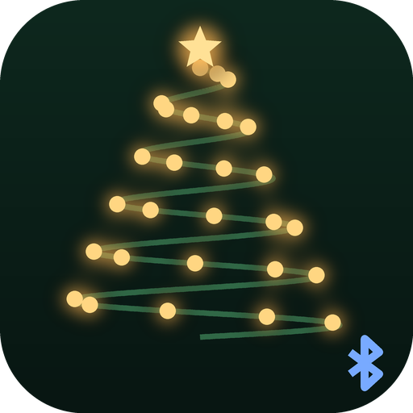

# BLE Christmas Lights for Home Assistant



[](https://github.com/WouterJN/homeassistant-ble-christmas-lights/actions/workflows/validate.yml)
[](https://github.com/WouterJN/homeassistant-ble-christmas-lights/actions/workflows/tests.yml)
[](https://github.com/WouterJN/homeassistant-ble-christmas-lights/actions/workflows/latest.yml)

Control Bluetooth (BLE) Christmas lights from Home Assistant: the cluster
lights and light strings that you normally control with the
[Lights App](https://play.google.com/store/apps/details?id=com.novolink.lightapp)
on your phone. In the Netherlands and Belgium these are sold at Action,
among others, as *kerstverlichting / clusterverlichting / lichtsnoer met
Bluetooth en app*.

No cloud and no extra hub needed: Home Assistant talks to the lights directly
over Bluetooth.

## Supported lights

Lights that show up in the Lights App and advertise over Bluetooth as
names like `LED-4-01-00000000` or `LED-4-02-00000000` (names that start with
`LED-<digit>-<two digits>`), such as the 5.5 m and 48 m versions. The Lights
App knows the kinds `LED-4`, `LED-5` and `LED-6`, each in the versions `01`,
`02`, `03`, `04` and `08`.

Do your lights advertise with another name? Please
[open an issue](https://github.com/WouterJN/homeassistant-ble-christmas-lights/issues)
with the name you see in a Bluetooth scanner app (such as nRF Connect).

## What you get

Per set of lights:

- A **light**, with on/off, brightness (the lights have 90 brightness steps)
  and the light modes from the app as effects.
- A **Timer** switch and the start and end time of three timers; see
  [Timers](#timers).
- A **Restore default settings** button: full brightness, cycling through all
  modes, and one timer from 18:00 to 23:59.

Several sets of lights can be put in a **group**, which is a light of its own
with the same switch, timers and buttons; see [Groups](#groups).

Home Assistant shows all of this in English, Dutch, German or French.

| Effect | Dutch name in Home Assistant |
| --- | --- |
| Stay on | Continu aan |
| Fast twinkling | Snel twinkelen |
| Fade away | Uitfaden |
| Twinkling in phase | Twinkelen in fase |
| Fade away in phase | Uitfaden in fase |
| Phasing | Faseren |
| Wave | Golf |
| All modes (cycles through all of them) | Alle modi |

The `modes` attribute of the light lists the modes that are active.

### A mix of modes

The lights can also cycle through a selection of modes. Use the action
`ble_christmas_lights.set_modes` for that:

```yaml
action: ble_christmas_lights.set_modes
target:
  entity_id: light.christmas_lights_eeff
data:
  modes:
    - stay_on
    - fade_away
    - wave
```

The modes are `stay_on`, `fast_twinkling`, `fade_away`, `twinkling_in_phase`,
`fade_away_in_phase`, `phasing` and `wave`. With a mix of modes, whether set
here or in the phone app, the light shows no effect; the `modes` attribute
shows the mix.

## Timers

The controller of the lights can switch them on and off by itself, also when
Home Assistant is not connected. It has three timers, each with a start and
an end time.

- The **Timer** switch decides whether the timers are used. While it is on,
  the lights are only lit between the start and the end of a timer. The light
  in Home Assistant then still shows as on outside those times: it shows
  whether the lights are switched on, not whether they are lit right now.
- **Timer 1 start** and **Timer 1 end** set the first timer. The second and
  third timer are disabled entities; enable them on the device page if you
  need them. A timer from 00:00 to 00:00 is not in use.

Home Assistant sets the clock of the controller to its own local time every
time it reads the state, so the timers follow the time zone and the summer
time of Home Assistant.

## Groups

Several sets of lights can be put in a group, as in the Lights App: the
lights in the tree and the ones on the fence, for instance, that should
always look the same.

### How a group works

A group is a device in Home Assistant with the same entities as a set of
lights: a light, the Timer switch, the timers and the Restore default
settings button. It also has a **Send settings to the lights** button.

- **A group has its own settings.** A new group starts on, at full
  brightness, cycling through all modes, with one timer from 18:00 to 23:59.
  The settings are kept when Home Assistant restarts.
- **Every change on the group goes to all its lights.** Switch the group
  light off, pick an effect on it or change a timer of the group, and every
  set of lights in the group gets that command. When one of them is out of
  reach, the others still get it.
- **Lights that connect get the settings of the group.** That happens when
  Home Assistant starts, when lights come back in range or are plugged in
  again, and when the connection was lost for a moment.
- **The group does not follow its lights.** It shows its own settings, not
  what the lights are doing. It is available as long as one of its lights can
  be reached.

So the group wins: a change you make on one set of lights, in Home Assistant
or with the phone app, lasts until those lights connect again. With **Stay
connected** turned off that is at most 5 minutes. Take lights out of the
group if they should go their own way.

### Making a group

1. Set up the lights themselves first; see [Setup](#setup).
2. Go to **Settings → Devices & services → Add integration → BLE Christmas
   Lights** and choose **Make a group of lights**.
3. Give the group a name and pick one to four sets of lights.

The group gives its lights its settings right away.

### Changing a group

Open the group under **Settings → Devices & services → BLE Christmas
Lights** and choose **Reconfigure** from its menu (⋮). You can change the
name and which lights are in the group. The group keeps its settings; lights
that you add get them, and lights that you take out are left as they are.

To remove a group, choose **Delete** from the same menu. The lights
themselves stay.

### Sending the settings to the lights

Normally there is nothing to do: changes go to the lights as you make them.

- **To change something**, use the entities of the group: the light, the
  Timer switch and the timers. In an automation or scene, use the group
  light like any other light:

  ```yaml
  action: light.turn_on
  target:
    entity_id: light.tree
  data:
    brightness_pct: 60
    effect: fade_away
  ```

- **To send everything again**, press **Send settings to the lights** on the
  group, or call it from an automation. Use it when lights were changed with
  the phone app and should go back to what the group says:

  ```yaml
  action: button.press
  target:
    entity_id: button.tree_send_settings_to_the_lights
  ```

## Installation

### HACS (recommended)

1. In HACS, open the menu (⋮) → **Custom repositories**.
2. Add `https://github.com/WouterJN/homeassistant-ble-christmas-lights` with
   type **Integration**.
3. Search for **BLE Christmas Lights**, install it and restart Home Assistant.

### Manual

Copy `custom_components/ble_christmas_lights` to the `custom_components`
folder in your Home Assistant configuration folder and restart Home Assistant.

## Setup

1. Switch the lights on and **close the Lights App on your phone**. The lights
   accept only one Bluetooth connection at a time.
2. Home Assistant discovers the lights by itself and shows them under
   **Settings → Devices & services**. You can also add them yourself with
   **Add integration → BLE Christmas Lights**.

Home Assistant needs a Bluetooth adapter within range of the lights. Outdoor
lights are often too far from the Home Assistant server; an
[ESPHome Bluetooth proxy](https://esphome.io/components/bluetooth_proxy.html)
close to the lights solves that.

### Using the phone app as well

Home Assistant normally keeps its connection to the lights open, so the phone
app cannot connect. To use both, open the lights under
**Settings → Devices & services → BLE Christmas Lights**, choose **Configure**
and turn off **Stay connected**. Home Assistant then only connects to send a
command and to read the state every 5 minutes, and closes the connection again
after 10 seconds. This also frees up a connection on a Bluetooth proxy.

The price: commands take a little longer, a change made with the phone app
can take up to 5 minutes to show, and the light can be unavailable in Home
Assistant while the phone app is connected.

## Troubleshooting

- **The light is unavailable**: the lights are out of range, switched off at
  the plug, or connected to your phone. Home Assistant reconnects as soon as
  it sees the lights again, and otherwise tries every 30 seconds. After a
  short drop the light keeps its state for up to 15 seconds while Home
  Assistant reconnects.
- **Reporting a problem or another controller**: open the lights under
  **Settings → Devices & services → BLE Christmas Lights**, choose
  **Download diagnostics** from the menu (⋮) and attach the file to your
  [issue](https://github.com/WouterJN/homeassistant-ble-christmas-lights/issues).
  It holds the advertised name and the raw data the controller sent, not the
  Bluetooth address.
- **Debug logging**: add this to `configuration.yaml`:

  ```yaml
  logger:
    logs:
      custom_components.ble_christmas_lights: debug
  ```

## Compared with the "Lights App" integration

This integration started as a replacement for the
[Lights App integration](https://github.com/JurajNyiri/HomeAssistant-Lights-App)
(`lights_app`) by Juraj Nyíri, which was the first to make these lights work
in Home Assistant and worked out the basics of the Bluetooth protocol. This
one is written from scratch, and checked against the Lights App itself.

The comparison is with that integration as it was in October 2026 (commit
`1174b90`).

### What you gain

| | Lights App integration | This integration |
| --- | --- | --- |
| Light modes | Seven separate switches | Effects of the light, plus an action for a mix of modes |
| Timers | Not available | Timer switch and three timers |
| Groups | Not available | Groups of up to four sets of lights, as in the app |
| Restore default settings | Not available | A button |
| Using the phone app as well | Not possible while connected | The **Stay connected** option |
| Names | Every set is called "Lights App" | Every set has its own name |
| Languages | English | English, Dutch, German and French |
| Diagnostics | Not available | A download to attach to an issue |
| Tests | None | An automated test suite, run on every change |

### Problems of the Lights App integration that are solved here

Wrong on the lights themselves:

- **Timers run at the wrong time.** Every time it reads the state, it sets
  the clock of the lights to 17:38:17. A timer you set in the phone app then
  no longer follows the real time.
- **Switching on or off turns the timers off.** The command it sends always
  disables the timers of the lights.
- **Lights that are on with their timers enabled show as off.**
- **"Auto Rotate" is not understood.** After choosing it in the phone app,
  the mode switches keep showing the modes that were selected before.
- **Only names ending in `-00000000` are accepted.** The phone app accepts
  any name that starts with `LED-`.

Wrong in Home Assistant:

- **A command that fails looks like it worked.** Errors while sending are
  only written to the log; the action itself reports no error.
- **The whole integration reloads after every lost connection**, instead of
  just reconnecting to the lights.
- **The lowest brightness shows as 0** while the lights are on.
- **Adding lights that cannot be reached gives an unexpected error**: the
  setup connects without handling a failure.
- **The links in Home Assistant to its documentation and issues are broken**:
  they point to `HomeAssistant-Light-App`, without the "s".

### Moving over

The two are not compatible: remove the old integration (and its HACS
repository), install this one and set up your lights again. The seven mode
switches are now effects of the light, so update automations and scenes that
used them.

## Development

```bash
python3.14 -m venv .venv
source .venv/bin/activate
scripts/setup
pytest
ruff check . && ruff format --check .
mypy
```

`requirements-dev.txt` pins the test framework, and with it the Home Assistant
version the tests run against. `scripts/setup` installs the Bluetooth
libraries at the versions that Home Assistant version needs.

Once a week the tests also run against the newest Home Assistant
(`scripts/setup --latest`). When that fails, fix what broke and raise the pin
in `requirements-dev.txt`.

The Bluetooth protocol is described in [docs/PROTOCOL.md](docs/PROTOCOL.md).
`protocol.py` implements it and has no Home Assistant dependencies.

## Credits

The Bluetooth protocol was first worked out by
[Juraj Nyíri](https://github.com/JurajNyiri) and contributors in
[HomeAssistant-Lights-App](https://github.com/JurajNyiri/HomeAssistant-Lights-App).
This project is a new implementation, written from scratch, with the meaning
of the commands taken from the Lights App itself.

## License

[MIT](LICENSE)
